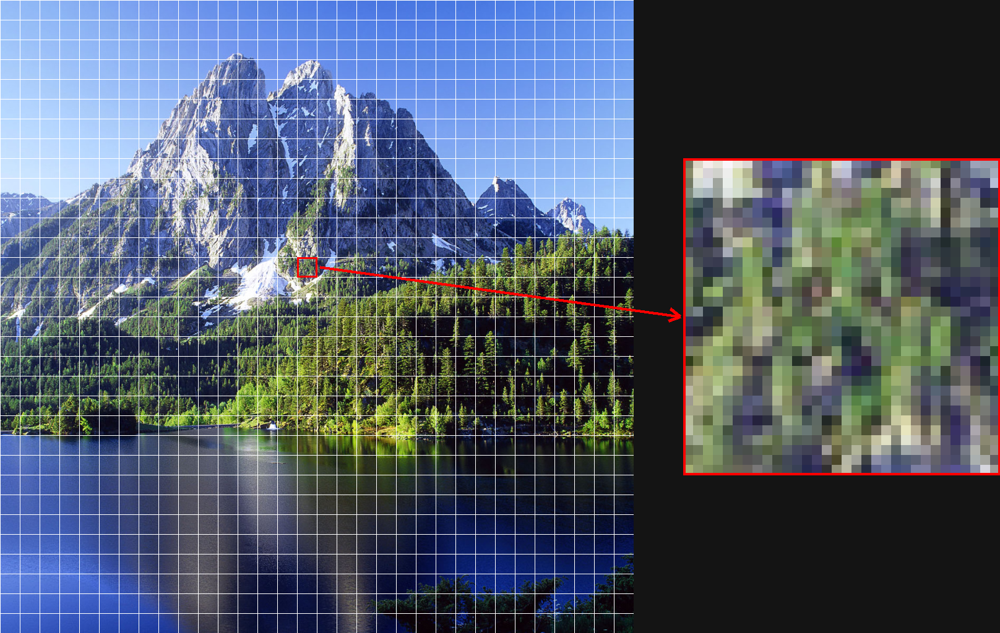
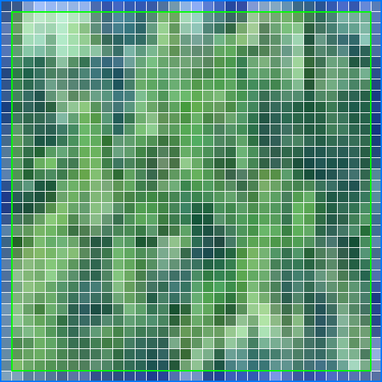
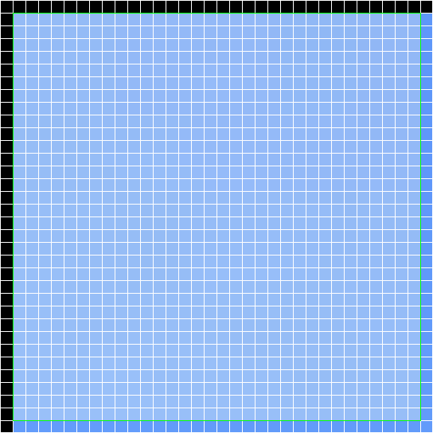
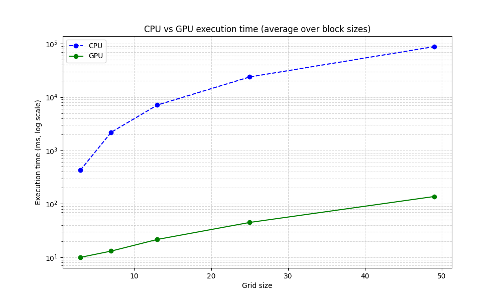
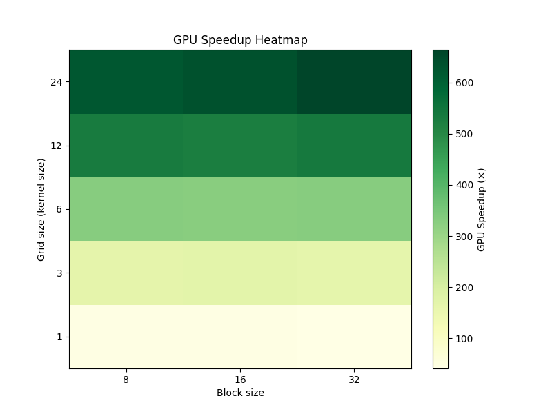
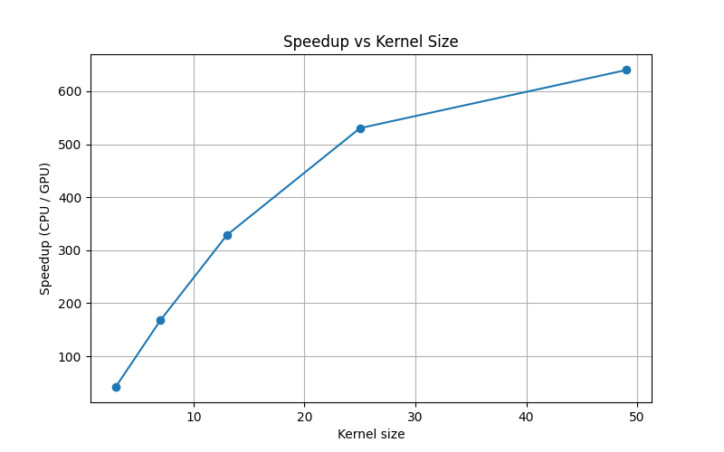

# 2D-Image-Filtering-CUDA

  

# Box Blur

3 channel input png image 

The blur used in this script is called a box blur, which computes each output pixel from the average of neighboring pixels of the base image, its intensity is define by a blur radius or kernel size of size $N\times N$ defined as:

Kernel size\
$(2\cdot\mathrm{grid} + 1) \cdot (2\cdot\mathrm{grid} + 1)$

Where grid is the distance from the center pixel to the furthest pixel from it, for example; 

$grid = 1 , 3\times3\  kernel$ \
$grid = 3 , 5\times5\  kernel$ 

This algorithm is of $O(n)^2$ complexity so the execution time grows quadratically with as the blur radius increases

# GPU Acceleration

In order to ease the computational load parallelism and shared memory optimization were used in conjuction with various techniques to boost the calculation speed.

The GPU implementation takes advantage of parallelism and shared memory
to reduce the cost of repeatedly accessing neighboring pixels.

1. Assign threads to output pixels.
2. Load the required image region into shared memory.
3. Include the surrounding halo pixels required by the blur kernel.
4. Synchronize the threads.
5. Calculate the blur using the shared-memory tile.
6. Write the resulting pixel to the output image.

  

## Parallelism

To make the most of parallelism the input image is divided into chunks of `BLOCK_SIZE × BLOCK_SIZE` pixels, where each chunk is assigned to a CUDA block and each thread is responsible for calculating one output pixel.

The global coordinates of the pixel processed by a thread are calculated
from its thread and block indices:

`int x = threadIdx.x + BLOCK_SIZE * blockIdx.x`

`int y = threadIdx.y + BLOCK_SIZE * blockIdx.y`

### Tiles

The `BLOCK_SIZE × BLOCK_SIZE` chunk assigned to each CUDA block is mapped into a shared-memory tile.

  

A tile is a square image segment that contains the original image chunk of BLOCK_SIZE × BLOCK_SIZE plus an outer edge in every direction cwith a width equal to the grid radius in pixels, known as a halo.

  

The halo is the outer region of the tile used to calculate the blur of the chunk edges using adjacent pixels outside of the chunk. This is done by loading the original image pixels that neighbor the outer pixels of the chunk. However, if a pixel corresponds to a position outside of the original image boundaries, the halo has to use a technique called zero padding.

### Zero Padding

The technique known as zero padding solves the problem of calculating the blur for the edge pixels of the original image, where neighboring pixels do not exist, by adding zero-value pixels to the halo. This provides enough values to compute the blur, however, it creates a dark border on the output image proportional to the grid radius.

  

As shown in the previous image, a chunk taken from the upper-left corner of the original image has black pixels added to the halo where neighboring pixels are not present, with the purpose of providing enough pixels around each original image pixel to compute its blur. Nonetheless, having zero values lowers the average thus creating a dark border around the output image.  

### Shared Memory

Shared memory is a fast memory space located on the GPU that is shared between all threads within the same CUDA block. It can be used to store data that is repeatedly accessed by multiple threads, reducing the need to access slower global memory.

Instead of having each thread repeatedly access neighboring pixels from global memory, the threads cooperatively load the required image region into shared memory. The pixels are loaded from global memory using coalesced memory accesses, where neighboring threads access neighboring memory locations, allowing the GPU to perform these accesses efficiently.

After the tile is loaded, the threads synchronize to ensure all pixels in the tile are available. Each thread then reads $(2\cdot\mathrm{grid}+1)^2$ pixels from shared memory to calculate its output pixel.

# Benchmark

In order to measure the algortihm's performance when it comes to execution time a benchmark was carried out for both the CPU and GPU implementation of the box blur, for the GPU test an NVIDIA RTX 3050 GPU was used.

With the intention of comparing how does the image resolution as well as the number of blocks launched at the kernel affect the speedup, a test srcipt was used which contemplates cpu and gpu warmup and does 15 runs for each indivdual configuration to extract average execution time with standard deviation thus providing more accurate results. The obtanined measurements are end-to-end blocking GPU pipeline vs CPU loop, meaning that individual kernel execution is not measured and only the time that the full blur algorithm takes is recorded.

| Kernel Size | Block Size | Avg CPU (ms) ±       | Avg GPU (ms) ±     | Speedup (×) |
|-------------|------------|----------------------|--------------------|-------------|
| **3×3**     | 8          | 434.009 ± 6.409      | 9.807 ± 0.165      | 44.256      |
|             | 16         | 429.104 ± 7.776      | 9.667 ± 0.185      | 44.387      |
|             | 32         | 426.052 ± 5.282      | 10.443 ± 0.396     | 40.796      |
| **7×7**     | 8          | 2135.579 ± 4.052     | 12.762 ± 0.098     | 167.335     |
|             | 16         | 2296.975 ± 50.580    | 13.421 ± 1.429     | 171.146     |
|             | 32         | 2144.785 ± 10.463    | 13.027 ± 0.249     | 164.645     |
| **13×13**   | 8          | 6837.037 ± 59.215    | 20.714 ± 1.545     | 330.074     |
|             | 16         | 7558.428 ± 281.267   | 23.118 ± 1.987     | 326.953     |
|             | 32         | 6892.799 ± 79.062    | 20.913 ± 0.403     | 329.586     |
| **25×25**   | 8          | 23520.955 ± 102.642  | 44.291 ± 2.922     | 531.053     |
|             | 16         | 23459.219 ± 202.633  | 44.772 ± 4.124     | 523.976     |
|             | 32         | 24426.783 ± 925.864  | 45.577 ± 4.426     | 535.941     |
| **49×49**   | 8          | 88621.828 ± 1720.532 | 142.777 ± 1.371    | 620.699     |
|             | 16         | 86137.703 ± 1458.251 | 135.484 ± 1.478    | 635.775     |
|             | 32         | 89228.289 ± 2671.449 | 134.277 ± 1.595    | 664.507     |

  

  

  

