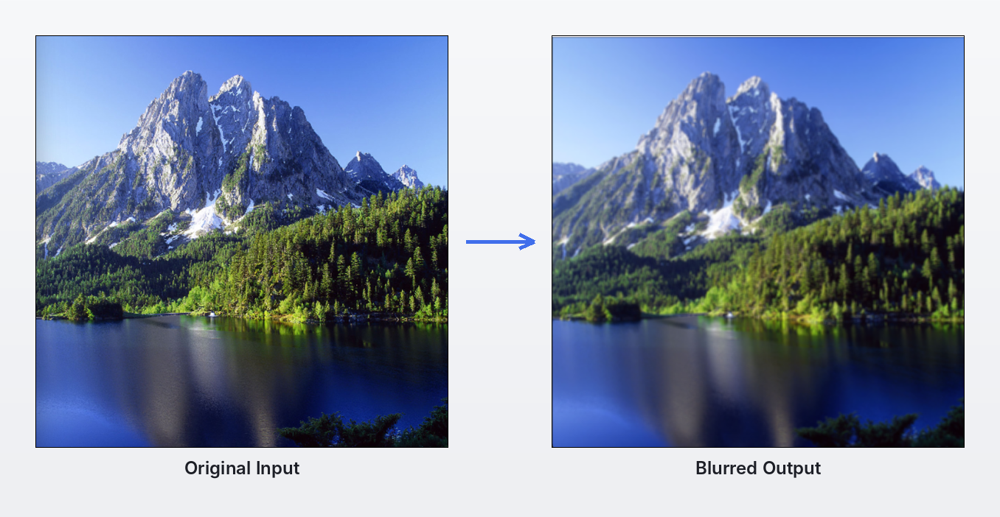

# 2D-Image-Filtering-CUDA

  

## Box Blur

This project applies a box blur to three-channel BGR PNG images using NVIDIA CUDA. The blur smooths an image by replacing each output pixel with the average of its neighboring pixels within a square region centered on that pixel. The blur intensity is controlled by a radius, called `grid` in this implementation, which determines the kernel dimensions $N\times N$:

The kernel dimensions are:\
$(2\cdot\mathrm{grid} + 1) \times (2\cdot\mathrm{grid} + 1)$

The radius represents the distance from the center pixel to the furthest pixel in each direction. For example: 

$grid = 1 produces a 3\times3\  kernel$ \
$grid = 3 produces a 7\times7\  kernel$ 

The computational complexity per output pixel is $O((2\cdot\mathrm{grid}+1)^2)$, meaning the computational work grows quadratically as the blur radius increases. Since each output pixel can be calculated independently, the algorithm is well suited for parallel processing. CUDA allows these calculations to be distributed across GPU threads, while shared memory reduces the cost of repeatedly accessing neighboring pixels.

## GPU Acceleration

The GPU implementation uses CUDA thread-level parallelism to distribute the blur calculations across GPU threads and shared-memory optimization to reduce repeated global-memory accesses. The following sections explain how the image is divided among CUDA blocks, how shared-memory tiles provide efficient access to neighboring pixels, and how each thread calculates its output pixel.

## Parallelism

  

First, the input image is copied from host memory (CPU memory) to device memory (GPU memory).

The image is then divided into chunks of BLOCK_SIZE × BLOCK_SIZE pixels, with each chunk assigned to a CUDA block. Each thread is responsible for calculating one output pixel.

The global coordinates of the pixel processed by a thread are calculated
from its thread and block indices:

`int x = threadIdx.x + BLOCK_SIZE * blockIdx.x`

`int y = threadIdx.y + BLOCK_SIZE * blockIdx.y`

Because calculating the blur requires neighboring pixels that may lie outside a block's assigned chunk, each block also loads the surrounding pixels needed for its calculations into a shared-memory tile.

### Tiles

Each CUDA block loads its assigned image chunk and the surrounding halo into a shared-memory tile.

  

A tile is a square image segment that contains the original image chunk of BLOCK_SIZE × BLOCK_SIZE pixels, plus a surrounding region called a halo. The halo extends by grid pixels in each direction.

  

The halo is the outer region of the tile that contains neighboring pixels outside the chunk, allowing threads to calculate the blur of pixels near the chunk edges. This is done by loading the original image pixels that neighbor the outer pixels of the chunk. However, if a pixel corresponds to a position outside of the original image boundaries, the halo has to use a technique called zero padding.

### Zero Padding

Zero padding handles the problem of calculating the blur for positions outside the original image boundaries, where neighboring pixels do not exist, by adding zero-value pixels to the halo. This provides enough values to compute the blur; however, it creates a dark border on the output image proportional to the grid radius.

  

As shown in the previous image, the halo of a chunk taken from the upper-left corner of the original image contains zero-valued pixels where neighboring pixels lie outside the image boundaries. These values provide the necessary padding to calculate the blur of pixels near the image edges. However, including zeros in the average lowers the pixel values, thus creating a dark border around the output image.

### Shared Memory

Shared memory is a fast memory space on the GPU that is accessible to all threads within the same CUDA block. It can be used to store data that is repeatedly accessed by multiple threads, reducing the need to access slower global memory.

Instead of having each thread repeatedly access neighboring pixels from global memory, the threads cooperatively load the required image region into shared memory. The pixels are loaded from global memory using coalesced memory accesses, where neighboring threads access neighboring memory locations, allowing the GPU to perform these accesses efficiently.

After the tile is loaded, the threads synchronize to ensure all pixels in the tile are available. Each thread then reads $(2\cdot\mathrm{grid}+1)^2$ pixels from shared memory to calculate its output pixel.

### Blur calculation

After the tile is loaded into shared memory, `__syncthreads()` is used to ensure that all threads have finished loading their portion of the tile before any thread begins the blur calculation.

The `if (x < width && y < height)` condition ensures that threads corresponding to pixels outside the image boundaries do not calculate or write an output pixel.

Each thread then iterates through the $(2\cdot\mathrm{grid}+1) \times (2\cdot\mathrm{grid}+1)$ neighborhood centered around its corresponding pixel. The pixel values are read from the shared-memory tile and accumulated separately for the blue, green, and red channels.

The total number of pixels in the neighborhood is stored in `count`. The average for each channel is then calculated by dividing its accumulated value by `count`, and the resulting BGR values are written to the corresponding pixel in the output image.

  
  
<em>Figure 1. Resulting blur image</em>

# Benchmark

In order to measure the algorithm's performance when it comes to execution time a benchmark was carried out for both the CPU and GPU implementation of the box blur. The GPU tests were performed using an NVIDIA RTX 3050.

With the intention of comparing how does the image resolution as well as the number of blocks launched by the kernel affect the speedup, a test script was used which includes cpu and gpu warmup and does 15 runs for each indivdual configuration to extract average execution time with standard deviation, providing a more reliable performance comparison.

The obtained measurements represent the end-to-end execution time of the GPU wrapper compared with the CPU implementation. Individual kernel execution time is not measured; instead, the time taken by the full blur algorithm is recorded.

| Kernel Size | Block Size | Avg CPU (ms) ± Std. Dev. | Avg GPU (ms) ± Std. Dev. | Speedup (×) |
|-------------|------------|----------------------|--------------------|-------------|
| 3×3         | 8          | 434.009 ± 6.409      | 9.807 ± 0.165      | 44.256      |
|             | 16         | 429.104 ± 7.776      | 9.667 ± 0.185      | 44.387      |
|             | 32         | 426.052 ± 5.282      | 10.443 ± 0.396     | 40.796      |
| 7×7         | 8          | 2135.579 ± 4.052     | 12.762 ± 0.098     | 167.335     |
|             | 16         | 2296.975 ± 50.580    | 13.421 ± 1.429     | 171.146     |
|             | 32         | 2144.785 ± 10.463    | 13.027 ± 0.249     | 164.645     |
| 13×13       | 8          | 6837.037 ± 59.215    | 20.714 ± 1.545     | 330.074     |
|             | 16         | 7558.428 ± 281.267   | 23.118 ± 1.987     | 326.953     |
|             | 32         | 6892.799 ± 79.062    | 20.913 ± 0.403     | 329.586     |
| 25×25       | 8          | 23520.955 ± 102.642  | 44.291 ± 2.922     | 531.053     |
|             | 16         | 23459.219 ± 202.633  | 44.772 ± 4.124     | 523.976     |
|             | 32         | 24426.783 ± 925.864  | 45.577 ± 4.426     | 535.941     |
| 49×49       | 8          | 88621.828 ± 1720.532 | 142.777 ± 1.371    | 620.699     |
|             | 16         | 86137.703 ± 1458.251 | 135.484 ± 1.478    | 635.775     |
|             | 32         | 89228.289 ± 2671.449 | 134.277 ± 1.595    | 664.507     |

  
  
<em>Figure 1. Execution Time Comparison</em>

  

  

# Result Analysis

# Conclusions
